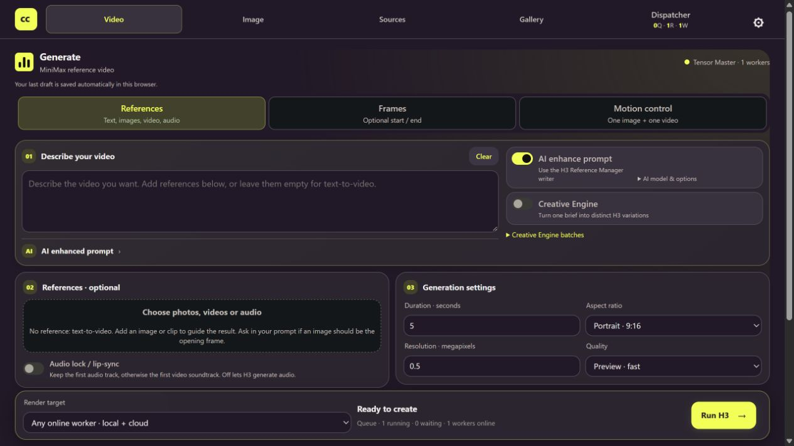
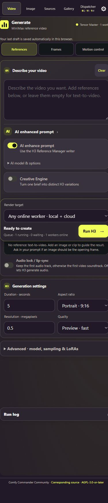

# Comfy Commander by Tensor Master

[](LICENSE)
[](https://github.com/mexxmillion/tensor-master-community/actions/workflows/ci.yml)

**Create on your own GPU. Scale to a worker fleet. Control it from your phone.**

Comfy Commander is a self-hosted workspace for ComfyUI image and video generation.
One interface brings together prompts, references, a persistent gallery, the job
queue, local workers and rented GPUs. It is an independent community project,
not an official Comfy.org product. Tensor Master remains the execution-engine name.



## What it does

| Feature | What you get |
|---|---|
| **One clear workspace** | Video, Image, Sources, Gallery and Dispatcher in one persistent navigation bar; queue, running-job and worker counts stay visible. |
| **Local and multi-GPU orchestration** | Route jobs across registered local/cloud workers by pool, VRAM, architecture and runtime profile. Scale from one GPU to a configured fleet; fleet and spending limits remain in force. |
| **GPU rentals** | Search Vast.ai / RunPod, review an offer and selected model profile, then explicitly confirm price, budget and lifetime. Cloud-only operation needs no local ComfyUI. |
| **Phone-ready UI** | The same responsive workspace through private Tailscale HTTPS. Setup shows the complete phone URL, including its port, with Copy. |
| **Image and video creation** | Qwen Image 2.1; H3 References, Start/End Frames and Motion control; Ref2V INT8, Singularity and FastH3 Omni profiles. |
| **Reference preprocessing** | Isolate a subject or garment, preview structure/depth, and crop, resize or trim video before generation. Preview, Save, then reuse the prepared reference. |
| **Creative Engine** | Turn one brief into distinct concepts, review the variations, then queue a batch with traceable prompts and settings. |
| **Motion and character replacement** | One character image plus one source video; approved SAM3 tracking → target-only inversion → H3, with audio lock and retained guide/mask evidence. Optional Character Swap v1.5 LoRA is off by default. |
| **Your media stays organized** | Controller-owned inputs, gallery/database and returned cloud outputs; full-frame thumbnails, playback, edit/rerun and traceable job/settings data. |
| **Profile-based setup** | Check ComfyUI, nodes and models; download only the chosen model set. Windows can prepare a separate managed runtime after a source/dependency review. |
| **Optional AI assistance** | Prompt enhancement, Creative Engine variations and workflow-import review through OpenRouter or an OpenAI-compatible endpoint, including a local LLM. AI assistance stays in prompt tools and workflow import. |
| **MCP integration** | Read status/profiles, analyze workflows and prepare graphs from an MCP client. Job submission is separately opt-in and confirmation-gated. |

The supported public scope is Qwen Image 2.1, MiniMax H3 Ref2VA, Singularity,
FastH3 and SAM3 replacement. Model licenses apply separately. Private identities,
credentials and model weights are not included in Git.

Commander drives ComfyUI through its API: a worker submits an approved workflow
with `POST /prompt`, follows progress through `/ws` and `/history`, and returns
media to the gallery. A replacement can chain SAM3 tracking, masking/inversion
and H3 in one workflow submission. ComfyUI remains behind the worker; using the
phone does not expose its API publicly.

## Install once

Requirements: Windows 10/11, Git and Python 3.12. No GPU or provider key is needed
to open Commander. Local generation additionally needs a compatible NVIDIA GPU,
ComfyUI runtime, custom nodes and the selected profile's models.

From PowerShell:

```powershell
git clone https://github.com/mexxmillion/tensor-master-community.git
cd tensor-master-community
py -3.12 -m venv .venv
.\.venv\Scripts\python.exe -m pip install -e .
.\.venv\Scripts\python.exe -m backend.service_start
```

Open [Setup](http://127.0.0.1:8000/setup), create your local admin password, and
choose **Local GPU**, **Local + cloud**, or **Cloud only**. Settings remains
available from the gear after onboarding.

- **Local:** select your ComfyUI folder and a starter profile. Review missing
  nodes/models and explicit downloads. For a fresh Windows machine, review the
  separate managed-runtime option. [Local setup](docs/local-setup.md).
- **Cloud:** connect a provider key through Connections. That human action also
  prepares the dedicated worker SSH pair; Vast registers only its public half.
  Choose an offer in Dispatcher → Rentals when you actually want paid capacity.
- **Model access:** public, ungated weights can download without an HF token.
  Gated/private files require your authorized read token and any access approval.
  Uploading LoRAs/models needs write access to the destination HF repository; prefer
  a fine-grained token scoped to that repository.
- **RunPod rental key:** enable GraphQL **Read/Write** for `api.runpod.io/graphql`
  and Pod read/delete access for monitoring and termination. Read-only or
  Serverless endpoint-only keys cannot create Pods. A successful connection
  check does not prove write access. [Provider permission setup](docs/STARTUP.md#provider-token-permissions).
- **Phone:** follow Setup / Settings → Phone access, install Tailscale on both
  devices, and use the copied private HTTPS URL. [Phone guide](docs/PHONE_ACCESS.md).
- **AI:** optional. Rendering and deterministic workflow validation do not need
  an LLM. [Endpoint configuration and model requirements](docs/LLM.md).

Connecting services, installing software or importing JSON does **not** rent a
GPU or submit a render. New installations start with an empty gallery and no
bundled credentials or weights.

## Start again after a reboot

1. Double-click **[Start Commander.cmd](Start%20Commander.cmd)** in this folder.
2. For local generation, start your configured ComfyUI.
3. Double-click **[Start Local Worker.cmd](Start%20Local%20Worker.cmd)**.
4. Confirm a fresh heartbeat in **Dispatcher → Workers**.

The launchers reuse saved configuration and avoid duplicate processes. A worker
retains its task checkpoint; it refuses to compete with another dispatcher
worker using the same ComfyUI. They do not reinstall packages, migrate keys or
launch paid capacity. [Startup, reconnection and troubleshooting](docs/STARTUP.md).

## Use it on your phone



Keep Commander bound to localhost. Tailscale Serve supplies private HTTPS;
ComfyUI stays behind the worker rather than being exposed to the phone. The PC,
Commander and Tailscale must remain running. Use the full URL shown in Settings
rather than guessing a hostname or port. [Complete phone setup](docs/PHONE_ACCESS.md).

Keys saved in Setup are stored on the computer running Commander. They are sent
to the relevant provider for validation and API use; a configured HF token is
also transferred over SSH to rented workers for model downloads. They are not
stored in a Tensor Master account. [Credential details](docs/STARTUP.md#where-credentials-go).

To stop the controller and local workers, use **Kill Commander.cmd** in that
installation folder. ComfyUI and paid rentals keep running. [Startup and shutdown](docs/STARTUP.md#stop-commander).

## Generation and deployment

H3 offers **References**, **Frames** and **Motion control**. Main controls are
duration, aspect, megapixels and quality. Preview uses the matching fast Turbo
recipe, Normal uses the eight-step recipe, and HQ uses 20 RES-multistep steps
without the automatic Turbo LoRA. Ref2V sparse attention is off by default;
FastH3 Omni uses VSA by default. Advanced controls retain seed, model, LoRAs and
SLA/VSA/SOL selection. Recipes preserve explicit selections.

Motion control defaults to five seconds, portrait 9:16, 0.5 MP, Normal/eight
steps and audio lock. Reference processing previews isolation/depth before Save; video preparation
crops, resizes and resamples the source to the requested output window.
A completed render still needs visual/audio QC, including its SAM3 evidence.

Tested short local workflows run on RTX 5070 Ti / RTX 5080-class **16 GB GPUs**
with 32 GB system RAM. Longer or larger jobs can require more memory. New job
requirements default to 16 GB; existing explicit requirements are retained.

Cloud runtimes use pinned public sources and model manifests. The selected
profile determines downloaded weights; shared models are reused. Controller
storage is independent of ComfyUI and survives removal of a rental worker.
User-owned LoRAs can be explicitly uploaded/registered through Models & LoRAs;
unknown workflow dependencies remain unresolved until reviewed.

## Guides and integrations

| Guide | Covers |
|---|---|
| [Clean install & recording](docs/CLEAN_INSTALL_RECORDING.md) | Empty checkout, isolated credentials, onboarding and a truthful end-to-end recording checklist |
| [Daily startup](docs/STARTUP.md) | Restarting, local worker reconnection, two GPUs, configuration and logs |
| [Local GPU setup](docs/local-setup.md) | ComfyUI, pinned nodes, model downloads and managed Windows preparation |
| [Optional LLM](docs/LLM.md) | OpenRouter / compatible endpoints, vision, native media, JSON and context sizing |
| [Phone access](docs/PHONE_ACCESS.md) | Tailscale, the complete URL, sign-in and troubleshooting |
| [MCP](docs/MCP.md) | Client configuration, tool boundaries, read-only smoke test and submission opt-in |

MCP uses `python -m backend.app.mcp_server` from this clone. It has no rental,
credential-change, upload, node-installation or destructive queue tools.
Submission requires both `COMMANDER_MCP_ALLOW_SUBMIT=1` and the exact tool
confirmation phrase; retain the returned job ID before retrying a timeout.

## Validation and community testing

```powershell
.\.venv\Scripts\python.exe -m pip install -e ".[dev]"
.\.venv\Scripts\python.exe -m pytest -q
```

Tests cover routing, guarded APIs, profiles, media preparation, local setup and
MCP. The stdio test initializes the real MCP subprocess, discovers tools, reads
status/profiles/resources and confirms submission is disabled without creating
jobs. LLM integration tests use mocked transports, not billable completions.

This is a community preview. Short local H3 runs, checkpoint reconnection and
real user-submitted jobs on both Vast.ai and RunPod have returned outputs.
A capped recovery test retained a package-download failure, resumed the same
instance and recovered an SSH interruption. A slow host still failed to finish
model sync within its original 30-minute limit; startup time is not guaranteed.

**A completely fresh Windows GPU/runtime installation and anonymous cold model
downloads still need recorded end-to-end testing.** Automated tests and a completed
job do not establish driver/wheel compatibility or visual/audio acceptance.

For a true fresh-install test, clone into a new folder without copying `.env`,
`state/`, `.venv`, credentials, gallery data or model weights. A machine-wide
credential environment variable or an old browser draft can otherwise make a
new checkout look configured. The [clean-install recording guide](docs/CLEAN_INSTALL_RECORDING.md)
includes an optional isolated session helper. Keep the working installation intact.

## Project and license

Source is licensed under [AGPL-3.0-or-later](LICENSE). See [NOTICE.md](NOTICE.md) and
[LICENSING.md](LICENSING.md) for attribution and component
licenses. The repository's default branch blocks force pushes and deletion;
review changes through pull requests.
