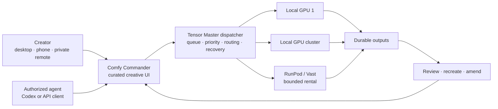
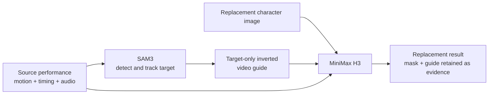

# Comfy Commander by Tensor Master — two-minute demo

## Core message

**Create from anywhere. Keep every job under control. Put elastic compute at your fingertips.**

Comfy Commander turns curated ComfyUI workflows into a portable creative studio with a managed queue, local and rented GPU workers, private remote access, reproducible jobs, and agent-friendly control.

## Teleprompter script

### 0:00–0:12 — The problem

> ComfyUI is incredibly powerful, but using it can mean managing nodes, models, machines, and queues before making anything. Comfy Commander moves that complexity out of the creative process.

### 0:12–0:28 — One portable studio

> It gives you one focused interface for desktop, remote desktop, or private access from your phone. Generate, monitor jobs, review outputs, and manage compute without living inside a node graph.

### 0:28–0:48 — The dispatcher

> Behind it, Tensor Master runs a managed dispatcher. Every generation becomes a durable job with a queue position, priority, compatible runtime, progress, and output. Recreate a job, amend the creative direction, or reroute it without losing the original setup.

### 0:48–1:08 — Scale without buying a farm

> Start with one GPU or scale to many. Add machines from your local network, then expand through RunPod or Vast whenever inspiration demands more capacity. Compute is available at your fingertips and can grow as far as the capacity and budget you authorize. The dispatcher keeps every worker, job, deadline, and cost ceiling under control.

### 1:08–1:29 — Curated creative workflows

> The experience is curated: MiniMax H3, FastH3, Qwen Image, Turbo presets, and one-shot character replacement. SAM3 tracks the performer, builds the target guide, and sends it into H3 while the source timing and audio stay attached.

### 1:29–1:47 — Agent-friendly

> The system is agent-friendly. An authorized tool such as Codex can prepare jobs, inspect workers, monitor progress, and help manage a larger shot list through the controller API. Safety rules remain in the dispatcher, not in the prompt.

### 1:47–2:00 — Close

> The goal is low friction, elastic capacity, and less technical setup—so a creator can move from an idea to one shot or a complete short film, from almost anywhere. This is Comfy Commander by Tensor Master: creativity first, scalable compute at your fingertips.

## Edit timeline and infographic plan

| Time | Picture | On-screen copy | Capture or graphic |
| --- | --- | --- | --- |
| 0:00–0:12 | Rapid contrast: ComfyUI graph, model folders, terminals, then clean Generate screen | **ComfyUI power. Without the setup tax.** | Screen capture; blur any private paths or credentials |
| 0:12–0:28 | Desktop UI slides into a phone frame showing the same private studio | **Desktop · Remote · Phone** | Use the real desktop and phone layouts |
| 0:28–0:48 | Job card enters Queue, passes through Dispatcher, then fans out to Worker 1 and Worker 2 | **Queue · Priority · Routing · Durable outputs** | Animated infographic over a dark Comfy-style grid |
| 0:48–1:08 | One GPU expands into a large local-and-cloud worker fleet; the creator controls the capacity dial | **One GPU or many. Elastic compute at your fingertips.** | Show RunPod/Vast discovery, quantity, and ceilings; do not launch a paid Pod for the recording |
| 1:08–1:29 | Split-screen character replacement: source motion + replacement identity → SAM3 target mask → H3 result | **Track · Guide · Replace** | Rights-cleared source and character only; show the real output |
| 1:29–1:47 | Prompt bubble becomes a supported job; status events return to an agent panel | **MCP server · Controller API · Dispatcher-enforced safety** | Record Codex reading farm status or preparing a job; show that submission remains opt-in and confirmation-gated |
| 1:47–2:00 | Outputs assemble into a short-film contact sheet; return to logo and GitHub URL | **Creativity first. Scalable compute at your fingertips.** | End card with repo, `#OpenSourceHiggsfield`, and MiniMax H3 credit |

## Infographic master

## Character-replacement graphic

## Recording notes

- Target 1:50–1:58, leaving a few seconds of safety under the two-minute limit.
- Read conversationally at roughly 135–145 words per minute, leaving room for pauses.
- Record the narration cleanly first, then cut visuals to the voice.
- Show only features that are live. The current product has an MCP server and controller API. Submission remains opt-in and confirmation-gated; autonomous demand-based scaling should not be presented as completed.
- Avoid private IP addresses, tokens, local paths, copyrighted footage, celebrity likenesses, or unlicensed music.
- Export 1920×1080 H.264 with AAC audio; upload publicly to YouTube and keep the original MP4 in a GitHub Release as backup.
